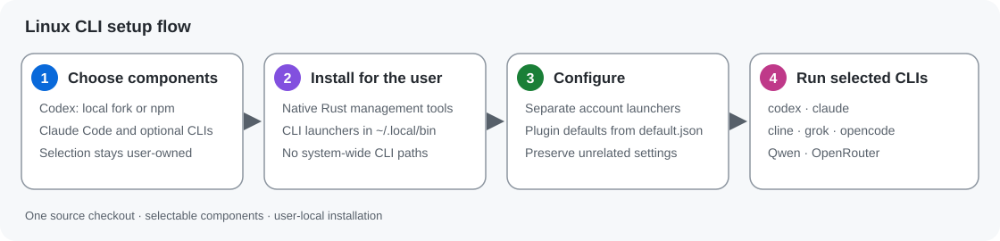

# Linux Codex and Claude Code Setup — Linux CLI Installer

Linux Codex and Claude Code Setup is a Linux CLI installer for developers who need isolated accounts, selectable Codex sources, and programming-prompts plugins.

It installs and configures vendor CLIs on Linux, with optional Cline, Grok, and opencode components. This repository is part of [installation_scripts](https://github.com/mikaeltorni/installation_scripts), which provides the wider setup framework.

[](https://github.com/mikaeltorni/linux_codex_claude_code_setup/commits/main) [](https://github.com/mikaeltorni/linux_codex_claude_code_setup/graphs/commit-activity) [](https://github.com/mikaeltorni/linux_codex_claude_code_setup/issues)

[Features](#linux-cli-installer-features) · [Installation](#linux-codex-and-claude-code-installation) · [Quick start](#quick-start-for-codex-and-claude-code) · [Configuration](#linux-codex-and-claude-code-configuration) · [FAQ](#linux-codex-and-claude-code-installation-faq) · [Usage](#linux-cli-usage-and-examples) · [Contributing](#contributing-to-the-linux-cli-installer) · [License](#mit-license-for-the-linux-cli-installer)



## Linux CLI installer features

- Install Codex from the local `~/projects/codex` fork or OpenAI's npm package.
- Install Claude Code and keep separate account launchers under the user's home.
- Select Cline, Grok, opencode, local Qwen Codex, and OpenRouter Codex components.
- Register selected `programming_prompts` plugins and per-skill defaults for Claude Code and Codex.
- Use native Rust management commands for marketplaces, model catalogs, account instances, and history sync.

The installed management commands, account launchers, provider launchers, and delayed updater are Rust binaries. Shell files retain Rust bootstrapping and the shared installer/authentication bridges; legacy Python implementations remain under `tests/reference` as parity oracles.

## Linux Codex and Claude Code installation

Run the barebones installer from a Linux user account with network access. It builds the native management tools and installs selected commands under the user's home; the npm Codex source also requires Node.js and npm.

```bash
bash install.sh --barebones --select codex_cli,claude_code
```

After installation, check the CLI versions and command paths:

```bash
codex --version
claude --version
command -v codex claude
```

### Quick start for Codex and Claude Code

To install Codex directly from npm rather than building the local fork, select that source:

```bash
bash install.sh --barebones --codex-source npm --select codex_cli,claude_code
```

See [OpenAI's Codex CLI guide](https://learn.chatgpt.com/docs/codex/cli) and [Anthropic's Claude Code setup guide](https://code.claude.com/docs/en/getting-started) for upstream sign-in and product usage.

## Linux Codex and Claude Code configuration

`default.json` is the committed source of truth for the programming-prompts marketplace and per-skill defaults. Claude Code registers the owner's [programming-prompts plugin catalog](https://github.com/mikaeltorni/programming_prompts) through `extraKnownMarketplaces`, and the installer enables plugins explicitly for both products. The local Codex fork is the default source; use `--codex-source npm` for the prebuilt package or `CODEX_INSTALL_SOURCE=npm` with the full installer.

## Linux CLI usage and examples

```bash
bash install.sh --barebones --codex-instances 3 --claude-instances 2
bash install.sh --barebones --codex-source npm --codex-instances 3 --claude-instances 2
bash install.sh --barebones --help
bash install.sh --list-components
bash install.sh --default
bash install.sh --select codex_cli,claude_code,cline_cli,grok_cli,opencode_cli
bash install.sh --select codex_cli,qwen_cli,openrouter_cli
bash scripts/sync_codex_fork.sh
```

### Choosing a Codex installation source

The local fork remains the default. To install the official prebuilt Codex
package directly from npm, use:

```bash
# Codex only, without ACC, plugins or a fork checkout/build.
bash install.sh --barebones --select codex_cli --codex-source npm

# Include Claude and standalone accounts using the same npm Codex runtime.
bash install.sh --barebones --codex-source npm \
  --codex-instances 3 --claude-instances 2

# After installing the native management commands, update npm Codex directly.
setup-install --select codex_cli --codex-source=npm

# Use npm through the full shared component installer or its interactive menu.
CODEX_INSTALL_SOURCE=npm bash install.sh --select codex_cli
CODEX_INSTALL_SOURCE=npm bash install.sh

# Switch back to the checked-out local fork.
bash install.sh --barebones --select codex_cli --codex-source fork
```

`--codex-source {fork|npm}` is a barebones/native option. It overrides
`CODEX_INSTALL_SOURCE`; without either, the source is `fork`. The full shared
installer uses the environment variable. Source selection applies to each
invocation: repeat the npm flag or environment variable when updating or
reconfiguring npm Codex. An ordinary Codex install without it selects the fork
again. `--codex-source=npm` and the space-separated form are equivalent.

The npm path runs `npm install -g --prefix STAGING -- @openai/codex@latest`,
following [OpenAI's npm installation guidance](https://developers.openai.com/cookbook/examples/codex/using_goals_in_codex).
It requires Node.js 16+ and npm, and uses the vendor's prebuilt platform package.
It does not clone or compile the Codex fork. This repository's Rust management
helpers still need to be built or available in `dist/`; the bootstrap supplies
Rust when necessary. On Ubuntu, missing system prerequisites can be installed
separately with `sudo apt-get install -y ca-certificates curl build-essential nodejs npm`.
The installer itself runs as the target user without a sudo prompt.

Both sources expose `~/.local/bin/codex` and share the dedicated prefix
`~/.local/share/linux_codex_claude_code_setup/npm`. `CODEX_NPM_PREFIX` can select
another absolute dedicated prefix; keep that choice stable on reruns. An npm
install replaces the whole managed prefix, including the fork revision marker,
after the staged runtime passes its version check. Download, package or smoke
check failures retain the previous prefix. The npm executable keeps its relative
package link so Node can locate its package metadata and platform binary.

Switching sources preserves existing login/configuration files, plugins, saved
account counts and the hook-trust preference. Recognized ACC tracking wrappers
are retained. The source checkout is untouched by npm installation. The
delayed Claude/Cline updater does not update either Codex source; rerun the
selected Codex install command for updates. Fork synchronization and the Reserve
opt-out postflight apply to the fork source.

For a vendor-only installation outside this repository's managed prefix,
OpenAI's command is `npm install -g @openai/codex@latest`. Use the managed
commands above to integrate standalone accounts and the saved hook preference.

New shells receive the user command directory automatically. Refresh an
already-open terminal after installation:

```bash
export PATH="$HOME/.local/bin:$PATH"
hash -r
codex --version
claude --version  # When Claude was selected.
```

### Generating the programming-prompts marketplace

`generate-marketplaces` reads `default.json` and plugin manifests under
`--prompts-root`, then writes local Claude and Codex catalogs and plugin links
under `--output`. `bash install.sh` builds and installs that native command.
Rust is bootstrapped when needed; there is no Python runtime fallback.

```bash
generate-marketplaces \
  --defaults default.json \
  --prompts-root ~/projects/programming_prompts \
  --output ~/.local/share/linux_codex_claude_code_setup/programming-prompts-marketplace
```

All three options are required paths. A missing plugin manifest exits 1.
Omitting an option exits 2. Normal setup runs through `bash install.sh`, which
invokes the generator with managed paths.

### Generating a Codex model catalog

`generate-model-catalog` writes `model-catalog.json` for a plain Codex home.
The model argument may end in `@variant`; that suffix is not part of the slug.
`QWEN_CODEX_CONTEXT_WINDOW` sets the context size, and a non-numeric value uses
40960. The qwen and OpenRouter CLI installers share its native catalog builder.

```bash
generate-model-catalog ~/.codex-qwen qwen3.8-27b
QWEN_CODEX_CONTEXT_WINDOW=131072 generate-model-catalog ~/.codex-openrouter stealth/ox-alpha
```

### Synchronizing Codex account history

`codex-history-sync sync` copies missing `sessions/**/*.jsonl` rollouts between
Codex homes and appends unique `history.jsonl` lines. Existing session files are
left in place. `--home` may be repeated; without it, the command uses
`CODEX_SYNC_HOMES` or the default provider homes under the current home.
`--quiet` suppresses the progress lines. Fewer than two existing homes exits 0
without copying. The `codexsync` launcher runs the installed native engine.

```bash
codex-history-sync sync --home ~/.codex --home ~/.codex-qwen
codexsync --quiet
```

### Configuring programming-prompts plugin defaults

`plugin-defaults` reads `default.json`. `list` prints one tab-separated catalog
row per prompt. `validate` checks that row against a prompts checkout.
`merge-claude`, `claude-hide-account`, `merge-instructions`,
`merge-opencode-config`, and `merge-grok-config` update settings without
dropping unrelated keys. The install commands link or copy a skill and refuse
to replace an unmanaged directory. The installer uses the native command for
these operations.

```bash
plugin-defaults --defaults default.json list
plugin-defaults --defaults default.json validate ~/projects/programming_prompts
```

The menu starts with a **CLIs** section containing Codex, Claude Code, Cline,
Grok, local Codex (`qwen`), OpenRouter Codex (`openr`), and opencode. Local
models and tracking-aware launchers belong to Agent Command Center, not this
CLI installer.
The core is intentionally minimal — each CLI installs and runs on its own —
and everything else is optional:

- `codex_cli` / `claude_code` / `cline_cli` — install each CLI. Selecting just
  one is enough. Claude Code is always installed and updated through the target
  user's `~/.local/bin/claude`; a dangling launcher is repaired, and a `claude`
  command inherited from another home is never reused. Cline is installed into
  an isolated user-owned npm prefix and linked as `~/.local/bin/cline`, matching
  its official `npm install -g cline` package without requiring sudo.
  By default, `codex_cli` builds the checked-out `main` branch of the user's
  `~/projects/codex` fork and installs its binary under a user-owned prefix.
  The installer clones a missing fork but never fetches, pulls, or merges an
  existing checkout. When `main` changes, the next install rebuilds it with
  visible Cargo progress and records the source revision.
  Run `bash scripts/sync_codex_fork.sh` to check and deploy that revision to
  all four installed Codex instances without reinstalling other CLIs.
  Select the official npm source with `CODEX_INSTALL_SOURCE=npm`, or the
  barebones `--codex-source npm` option described above.
- `qwen_cli` — installs the local Codex (`qwen`) CLI into its isolated home
  (`~/.codex-qwen`) using the managed runtime from main
  `codex`, and puts a plain `qwen` launcher on `PATH`. Tracking-aware `qa`
  belongs to Agent Command Center.
- `openrouter_cli` — installs the OpenRouter Codex (`openr`) CLI into
  `~/.codex-openrouter` using the same managed runtime as main
  `codex`, and puts a plain `openr` launcher on `PATH`. Tracking-aware `oa`
  belongs to Agent Command Center.
- `grok_cli` — runs xAI's official `https://x.ai/cli/install.sh` installer,
  then promotes the binary to Grok's **alpha** release channel (`grok update
  --alpha`) so clean installs track pre-stable builds. Override
  `GROK_INSTALL_URL`, `GROK_COMMAND`, `GROK_HOME`, `GROK_CHANNEL` (`alpha` or
  `stable`, default `alpha`), `GROK_VERSION` (pin a specific build, e.g.
  `0.2.92`), or `GROK_API_KEY_ENV`; set `GROK_MODEL_NAME`, `GROK_MODEL_ID`, and
  `GROK_MODEL_BASE_URL` together to merge a custom model without replacing
  unrelated `~/.grok/config.toml` settings. Authentication uses the environment
  variable named by `GROK_API_KEY_ENV` (default `XAI_API_KEY`).
- `opencode_cli` — runs opencode's official `https://opencode.ai/install`
  installer (binary at `~/.opencode/bin`), links `~/.local/bin/opencode`, and
  merges installer-managed defaults into `~/.config/opencode/opencode.json`
  without disturbing unrelated keys: the default model (`OPENCODE_MODEL`,
  default `opencode-go/glm-5.2`) and its reasoning variant (`OPENCODE_VARIANT`,
  default `high`; glm-5.2 exposes only `default`/`high`/`max`), applied per
  built-in agent (`build`, `plan`). It also sets `"permission": "allow"` (yolo
  mode) so opencode auto-approves tool actions. Provider authentication is left
  to opencode's own `opencode auth login` — no API key is read or written.
  Override `OPENCODE_INSTALL_URL`, `OPENCODE_COMMAND`, `OPENCODE_INSTALL_DIR`, or
  `OPENCODE_CONFIG_HOME`.
- `agent_autoupdate` — a systemd **user** timer that, at user-manager startup
  (the first user session after a system reboot) and once a day, updates every
  installed Claude Code and Cline runtime to the newest stable release that
  has been published for at least 24 hours. Codex stays on its separately
  selected fork or npm installation. Tune the delay via
  `AGENT_AUTOUPDATE_DELAY_HOURS` in
  `~/.config/linux_codex_claude_code_setup/autoupdate.env`.
- `codex_history_sync` — installs `codexsync`, a non-destructive union merge of
  Codex chat history across every provider home (`~/.codex`, `~/.codex-qwen`,
  `~/.codex-openrouter`, `~/.codex-nvidia`). Each provider keeps its own session
  store, so a chat started on one is normally invisible to the others' `resume`
  pickers. `codexsync` copies every home's `sessions/` rollouts and unions each
  `history.jsonl` into all homes, so any session can be continued from any
  provider interchangeably. It only ever copies missing files and de-duplicates
  history lines — nothing is deleted or overwritten — so it is safe to run
  repeatedly. Run `codexsync` on demand; ACC owns automatic history-sync
  integration in its tracking-aware runtime. Override the set
  of homes with `--home DIR` (repeatable) or the `CODEX_SYNC_HOMES` env var.
- `agent_instances` — optional standalone account provisioning. It configures
  `cx1`/`codex1`, `cx2`/`codex2`, and numbered Claude aliases without ACC.
  Fresh component installs choose three Codex accounts and one Claude account;
  use the configure action or explicit counts to change them.
- `codex_hook_trust` — enabled by default. Adds the saved hook-review bypass at
  the common Codex launch point. Uninstalling this component restores review.
- `plugin-*`, `skill-*`, and `dispatch-skill-*` — separate **Plugins** and **Skills** menu sections,
  with one independently selectable component per `programming_prompts` entry.
  Each selected skill is also linked into Cline's documented global
  `~/.cline/skills/` and Cursor's `~/.cursor/skills/` directories; unrelated
  user-authored skills are never overwritten. Cline also receives full plugin bundles under `~/.cline/plugins/`
  so skills, hooks, agents, and MCP definitions stay discoverable in every
  session, mirroring the Grok treatment. Grok receives native `~/.grok/skills/`
  links, and full plugins are linked under `~/.grok/plugins/` so skills, hooks,
  agents, and MCP definitions remain discoverable even when Claude Code is not
  selected. opencode receives the same treatment natively under
  `~/.config/opencode/skills/` and `~/.config/opencode/plugins/`. The SSH VM
  native skill installs by default and loads only when remote SSH deployment or
  testing is relevant. Migrating it removes only its previous managed plugin
  registrations and links.
- The retired `general-programming-guidelines` prompt has been removed from
  the source catalog and installation menu.
  Agent Command Center selects independent V2 workflow, commits, worktree,
  docs, and testing skills, and removes legacy generic instruction blocks
  during its installer postflight. User-selected skills remain intact.
  `bash scripts/install_programming_plugins.sh verify` checks current default
  native skills and flags leftover managed generic instructions without
  requiring the deleted source.

Agent Command Center's Claude integration loads project `AGENTS.md` files at
session start.

The installer is sudo-free by default. It clones `programming_prompts` when a
sibling checkout is unavailable, preserves unrelated Claude settings, and
generates Codex and Claude marketplace catalogs under the target user's local
share directory. `programming_prompts` remains content-only and carries one
Codex manifest, one Claude manifest, and one skill per plugin.

For screen sharing and demos, the `claude_code` component hides the signed-in
account email and organization from the Claude Code UI by merging
`CLAUDE_CODE_HIDE_ACCOUNT_INFO=1` into the `env` block of
`~/.claude/settings.json` (its native, documented privacy switch). Only that one
key is managed; every other user setting is preserved, and the `claude_code`
uninstall clears it again. Codex has no equivalent: as of codex-cli 0.142 there
is no config key, env var, or `tui.status_line` item that hides the account
email (it surfaces in the welcome view and `/status`), so nothing is wired for
Codex rather than relying on a fragile output-redaction hack.

Rich Codex, Claude Code, and Cline display integration belongs in the sibling
`claude_code_status_bar` repository. Cline already supplies its rich native TUI;
there is no unsupported settings rewrite here.

## Linux CLI installer verification commands

```bash
python3 -m pytest -q
bash -n install.sh lib/*.sh installer/components.sh
```

Run `bash scripts/verify_release.sh` for the full gate: strict Clippy, Rust
tests, a locked release build, and pytest. Python 3.11+ and pytest are development
requirements; the retained Python reference implementations use the standard
library. The upstream Codex code-mode build can also require Python as a build
tool. The npm package-context tests also require Node.js.

The npm source change passed the full gate (including 181 Python tests), source
switching tests, and two real `@openai/codex@latest` installs into an isolated
local home on 2026-10-21. Codex `0.163.0`, `cx1`/`cx2`/`cx3`, saved hook
preferences, unchanged fixture credentials/configuration and shell PATH all
passed. This npm run was local; the VM result below covers the fork source.

## Detecting, reconfiguring, and uninstalling CLI components

This installer tracks what it has installed and can re-apply or remove it, so you
can refresh configuration after a repo update or cleanly back a feature out.

```bash
bash install.sh --detect            # show each component as installed|absent
bash install.sh --reconfigure a,b   # re-apply (idempotent) these component ids
bash install.sh --uninstall a,b     # uninstall these component ids
```

In the interactive menu (run `bash install.sh` on a terminal, or via the master
installer), already-installed components show a green `✓`. Select one with
**space** to **reconfigure** it (`~`), press **`u`** to mark it for **uninstall**
(`✗`), or press **`r`** to reconfigure every installed component at once. Detection
uses a live check where deterministic and otherwise an install receipt under
`${XDG_STATE_HOME:-~/.local/state}/isc/receipts/`; a component without a reversal
step simply clears that receipt on uninstall.

## Project scope and MIT disclaimer

This software is provided under the MIT License on an **“as is”** basis, without warranties of any kind. To the maximum extent permitted by applicable law, the authors and copyright holders shall not be liable for any claims, damages, losses, or other liability arising from the use of this software.

You are solely responsible for determining whether this software is suitable, safe, lawful, and appropriate for your intended use. Unless explicitly stated otherwise, this project is general-purpose software and is not designed, tested, certified, or approved for safety-critical, medical, automotive, aviation, industrial-control, life-support, cybersecurity-critical, financial-critical, or other high-risk use cases.

The authors and copyright holders make no guarantees regarding security, reliability, availability, correctness, compliance, non-infringement, or fitness for any particular purpose.

This notice is intended to clarify the nature of the project and does not impose additional restrictions beyond the MIT License.

## Codex GPT Reserve switching

For the fork source, the installer postflight sets `[features] luna_reserve_auto_switch = false` in
`~/.codex/config.toml`, every existing `~/.codex-*` home, and each separate
`*.config.toml` profile. It uses the native Codex TOML editor on private copies
and preserves unrelated settings/comments. Repeated installs keep the opt-out.
The selected local fork must contain the Reserve opt-out feature; restart or
resume existing CLI sessions after rebuilding that runtime.

Use `bash install.sh --select codex_cli` to install the native runtime and apply
the policy. Its standalone configuration entrypoint is
`codex-reserve-policy --home /path/to/home --codex /path/to/native/codex`.
It accepts those two required path options and `--help`. The regression runner
is `python3 -m unittest discover -s tests -p test_codex_reserve_policy.py -v`;
see [coverage](tests/reserve_policy_coverage.md) for isolated native-RPC checks.

### Selecting a branch in the local Codex fork

`CODEX_FORK_REF` selects a local branch for native/provider builds. When unset,
the installer reads `~/.config/linux_codex_claude_code_setup/codex-fork-ref`;
without either selection it uses `main`. Branch names are validated, missing
branches are rejected, and selection never changes the source checkout.

Check selection with `bash tests/test_codex_fork_selection.sh`; the fixture
covers default/saved/explicit choices, invalid/missing refs, and unchanged Git
state after failures. `bash tests/test_codex_fork_install.sh` verifies publishing.


## Installing standalone Linux CLI accounts

`bash install.sh --barebones` installs Codex and Claude without ACC, the shared
installer framework, or a programming-prompts checkout. It runs `setup-install`,
which accepts `--default`, `--select`/`--reconfigure`, `--home`,
`--codex-source {fork|npm}`, `--codex-instances`, `--claude-instances`,
`--list-components`, and `--help`, plus the hook-trust flags below.
The barebones component IDs are `codex_cli`, `claude_code`, `agent_instances`,
and `codex_hook_trust`.

```bash
# Core CLIs and three independent Codex logins plus two Claude logins.
bash install.sh --barebones --codex-instances 3 --claude-instances 2

# Configure aliases for CLIs that are already installed.
bash install.sh --barebones --select agent_instances \
  --codex-instances 3 --claude-instances 2
agent-instances list
agent-instances configure --codex 3 --claude 2
agent-instances reapply

# The same account configuration through the full component installer.
CODEX_INSTANCE_COUNT=3 CLAUDE_INSTANCE_COUNT=2 \
  bash install.sh --select agent_instances
```

`agent-instances configure [--codex COUNT] [--claude COUNT] [--home PATH]`
requires at least one count; an omitted product retains its saved count.
`list` and `reapply` accept `--home PATH`, and `--help` prints usage. Counts
include account 1. Zero disables managed aliases while retaining account data.
Settings are saved in `~/.config/linux_codex_claude_code_setup/instances.json`.

| Account | Aliases | Configuration/login home |
| --- | --- | --- |
| Codex 1 | `cx1`, `codex1` | `~/.codex` |
| Codex N | `cxN`, `codexN` | `~/.codex-account-N` |
| Claude 1 | `cc1`, `claude1` | `~/.claude` |
| Claude N | `ccN`, `claudeN` | `~/.claude-account-N` |

Sign in separately through each CLI, for example `cx2 login`. Credentials are
never copied between accounts. Existing account directories must be real
directories. Unrelated commands are protected from replacement; recognized old
ACC aliases are backed up under the setup share directory and can be restored
when the managed alias is disabled. The normal tracking-aware `codex` wrapper
is preserved when ACC is present.

For the fork source, the barebones builder uses `CODEX_FORK_DIR` (default `~/projects/codex`) and the
selected local fork ref. That selected branch must be checked out with a clean
`codex-rs` tree. A missing checkout is cloned from `CODEX_FORK_REPOSITORY_URL`
(default `https://github.com/mikaeltorni/codex.git`). The builder records the
revision, repairs missing native artifacts, and builds `codex-code-mode-host`
when that package is present. Existing source checkouts are never switched or
updated automatically. The full shared installer retains its fork-build helper
for ACC integration.

When the fork includes `scripts/codex_package/v8.py`, the native builder calls
that upstream Python 3.11+ helper before Cargo. It obtains the fork's pinned V8
archive and Rust bindings, verifies their checksums, and caches them under
`~/.cache/linux_codex_claude_code_setup/v8`. Artifact verification failures stop
the build before replacing the installed Codex payload. Explicit `RUSTY_V8_ARCHIVE` /
`RUSTY_V8_SRC_BINDING_PATH` pairs and `V8_FROM_SOURCE` retain the helper's
upstream behavior.

Use an existing absolute home with `--home`. Native commands report missing
build tools with remediation instead of prompting for sudo. Fork Codex needs a Rust
and C/C++ build environment, Git, CMake, and pkg-config, plus Python 3.11+ for
forks using the V8 helper; npm Codex needs Node.js 16+ and npm. Cline needs Node.js 22
and npm. Vendor installation also needs curl, Bash, and coreutils. When invoked
through sudo, the bootstrap hands user work back to the desktop user. Installed
commands live under `~/.local/bin`; add it to the current shell's `PATH` after
installation. Future Bash/login shells receive the PATH entry automatically.

### Configuring the Codex hook trust preference

Hook-trust skipping is enabled in the committed defaults and can be controlled
independently of account counts:

```bash
bash install.sh --barebones --skip-hook-trust-confirmation
bash install.sh --barebones --require-hook-trust-confirmation
setup-preferences hook-trust skip
setup-preferences hook-trust require
setup-preferences hook-trust show
setup-preferences hook-trust reapply
```

All preference commands accept `--home PATH`. Barebones reruns retain a saved
choice unless a flag overrides it. The full installer's `codex_hook_trust`
component explicitly enables skipping; its uninstall restores review. The
choice is stored in
`~/.config/linux_codex_claude_code_setup/preferences.json`.

The native launcher adds Codex's documented
[`--dangerously-bypass-hook-trust`](https://learn.chatgpt.com/docs/hooks)
flag, which runs enabled hooks without their individual trust review. It acts
at the common raw entrypoint, covering standalone aliases and existing ACC
wrappers for either Codex source. The payload is retained as `bin/codex-native`
(a package-relative link for npm); each entrypoint is published through an atomic
replacement. This preference controls hook review only.

## Native Rust management commands for Codex and plugins

The full installer and master installer keep their existing selection,
detection, reconfigure, and uninstall interfaces. Their optional component
functions delegate to these native owners. In the forms below, braces denote
alternatives: choose one value.

```text
setup-component {install|detect|uninstall} {cline_cli|grok_cli|opencode_cli} [--home PATH]
setup-provider {install|configure|detect|uninstall|status-line} {qwen|openrouter} [--home PATH] [--config PATH]
agent-autoupdate {run|install|detect|uninstall} [--home PATH] [--delay-hours HOURS]
agent-autoupdate resolve INSTALLED_VERSION HOURS NOW_UNIX < npm-times.json
npm-prefix install ABSOLUTE_PREFIX PACKAGE_SPEC
setup-json marketplace-root NAME < cli-state.json
setup-json contains {ARRAY_FIELD|-} KEY VALUE < cli-state.json
setup-json claude-marketplace FILE NAME DIRECTORY
setup-json --help
codex-reserve-policy --home HOME --codex NATIVE_CODEX
codex-reserve-policy --help
```

`setup-provider configure` merges provider TOML/catalog defaults without
installing a CLI. `--config` chooses the provider configuration directory.
`status-line` reads the display owner's selection. Installed `qwen` and `openr`
aliases use the native provider launcher, preserve user arguments and exit
status, and delegate to ACC when it is available. Provider uninstall preserves
configuration and authentication. ACC continues to own tracked shorthand
commands and local model selection/downloads.

`agent-autoupdate` with no arguments is equivalent to `run`. Its native service
updates Claude and Cline independently, keeps the publication delay, selects
stable versions in numeric order, and never downgrades a recognized installed
stable version. Delay hours must be finite and nonnegative. The resolver reads
npm's timestamp JSON from stdin and prints a version only when eligible.
The user timer runs after user-manager startup and daily; package/network
failures during a scheduled update preserve the existing installation.
`npm-prefix` stages the package and uses Linux atomic directory exchange;
unsupported exchanges fail while retaining the previous tree.

### Installing and verifying programming-prompts components

```bash
bash scripts/install_programming_plugins.sh
bash scripts/install_programming_plugins.sh verify

SETUP_SOURCE_DIR="$PWD" setup-prompts install-defaults \
  --defaults "$PWD/default.json" \
  --prompts-root "$HOME/projects/programming_prompts"
```

`setup-prompts` accepts these actions:

```text
install-defaults
verify
install-plugin PLUGIN SKILL
install-skill PLUGIN SKILL
install-dispatch PLUGIN SKILL
ensure
generate
homes
prepare-codex CODEX_HOME
prepare-claude
claude-marketplace-matches
global PLUGIN
global-selected [PLUGIN ...]
cleanup-legacy PLUGIN SKILL
cleanup-marketplace PLUGIN
resolve-source PLUGIN SKILL
skill {cline|cursor|grok|opencode} PLUGIN SKILL
bundle {cline|grok|opencode} PLUGIN
verify-file TARGET SOURCE LABEL
verify-retired TARGET
```

All actions accept `--home`, `--defaults`, `--prompts-root`, `--marketplace-dir`,
`--codex`, `--claude`, and `--opencode-config` path options. Repeat
`--codex-home PATH` to target explicit accounts. Otherwise `CODEX_HOMES` selects
legacy homes, or all existing `.codex`/`.codex-*` homes are discovered. Use `--`
to end option parsing when a literal operand starts with a dash.

Keep the source distribution available: `SETUP_SOURCE_DIR` locates its
checkout/authentication bridge and default catalog when installed elsewhere.
Repository clone/update authentication remains delegated to the shared
`ensure_linked_repository` helper. `PROGRAMMING_PROMPTS_REPOSITORY` overrides
the catalog repository selection. Existing non-Git content directories can be
used directly through `--prompts-root`.

Only default-on catalog entries are installed by `install-defaults`.
Dispatch skills stay on demand and never contribute global instruction bodies.
The verifier checks installed default skill bodies across the selected Codex
homes and Claude, Cline, Cursor, Grok, and opencode, and rejects retired generic
instruction blocks. Verification and query actions do not modify those files.
`claude-marketplace-matches` returns 1 for a different/missing registration.

### Low-level Linux CLI defaults operations

Use `plugin-defaults --defaults FILE` followed by one of these forms:

```text
list
validate PROMPTS_ROOT
merge-claude SETTINGS [--marketplace-dir DIRECTORY] PLUGIN [PLUGIN ...]
claude-hide-account [--disable] SETTINGS
merge-instructions TARGET NAME BODY
cleanup-legacy HOME PROMPTS_ROOT PLUGIN SKILL [--codex-home PATH]
cleanup-migrated-plugin HOME PROMPTS_ROOT PLUGIN MARKETPLACE
install-direct-skill HOME PROMPTS_ROOT PLUGIN SKILL [--codex-home PATH] [--source-dir {skills|dispatch-skills}]
install-{cline|cursor|grok|opencode}-skill HOME SOURCE_SKILL NAME
install-{cline|grok|opencode}-plugin HOME SOURCE_PLUGIN NAME
merge-opencode-config TARGET PROVIDER/MODEL {default|high|max}
merge-grok-config TARGET NAME MODEL_ID BASE_URL API_KEY_ENV_NAME
```

`generate-marketplaces`, `generate-model-catalog`, `codex-history-sync`, and
`codexsync` retain the forms described above. Calling `codex-history-sync`
without operands is also supported; `--quiet` requires its `sync` selector.
`plugin-defaults --defaults` precedes the operation. Native trace diagnostics go
to stderr while query output remains on stdout.

## Verifying the Linux CLI installation in a clean Ubuntu VM

Run the saved smoke test inside the intended test VM after installing build
prerequisites and making the source checkout available:

```bash
bash scripts/verify_vm.sh
```

It installs twice into a new isolated home, provisions three Codex and two
Claude accounts, checks all seven CLI/alias version commands, checks the native
instance engine, and verifies that ACC and programming-prompts were not cloned.
`VM_TEST_HOME` selects a retained evidence directory; `CARGO_HOME` and
`RUSTUP_HOME` can point to the VM's existing toolchain cache. Login/API calls are
not part of this installation smoke test. Local release checks do not establish
that a VM run has passed.

Verified on 2026-10-21 in a clean Ubuntu 24.04.5 LTS live VM (x86_64), using
commit `9da990b`, installed build prerequisites, and a separate 24 GiB build
disk. Both installation passes and all seven version probes passed with
Codex `0.162.1` (fork revision `99fcf7b19a30652da9363581d4fdb95241e112ca`)
and Claude Code `2.1.306`. The saved account counts were 3/2, hook-trust skipping
was enabled, and numbered account directories had mode 0700. Installed native
binaries matched the VM build artifacts; neither ACC nor programming-prompts
was cloned. This verifies installation and CLI startup; account authentication
and model/API calls were not exercised.

## Linux Codex and Claude Code installation FAQ

### Does this installer replace the official Codex or Claude Code tools?

No. It installs and configures vendor CLIs on Linux, including the official Claude Code installer and either the upstream Codex npm package or the local Codex fork. The setup repository provides account, source, and plugin management around those tools.

### How do I choose the Codex installation source?

Use `--codex-source npm` with the barebones installer or `CODEX_INSTALL_SOURCE=npm` with the full installer to select OpenAI's npm package. The checked-out local Codex fork remains the default when no source override is supplied.

### Can I install only Claude Code or Codex?

Yes. Pass `--select claude_code` or `--select codex_cli` to the barebones installer to install only that CLI. Add `--codex-source npm` when selecting Codex if you do not want to build the local fork.

### Can I keep separate Codex and Claude Code accounts?

Yes. The installer supports multiple Codex and Claude Code instances and creates separate account launchers under the target user's home. Set the requested counts with `--codex-instances` and `--claude-instances`.

### Does the barebones Linux installation require sudo?

The barebones installer runs as the target user and installs its commands under that user's home. Installing missing operating-system build prerequisites through a package manager may require administrator access.

### Where are programming-prompts plugin defaults configured?

The repository's `default.json` controls marketplace registration and per-skill defaults for Claude Code and Codex. The `plugin-defaults` native command validates and updates the selected plugin configuration while preserving unrelated settings.

### What is needed to install Codex from npm?

The npm Codex source requires Node.js and npm, while the local Rust management tools still need to be built or present in `dist/`. The barebones bootstrap supplies Rust when necessary and leaves the selected Codex source explicit for each installation.

## Contributing to the Linux CLI installer

This private repository is maintained for the owner's Linux CLI setup. Keep `default.json` as the committed source of per-skill defaults, preserve unrelated settings under the target user's home, and maintain clean installation through `install.sh`. For code changes, use the documented release gate and a clean Ubuntu VM run appropriate to the changed behavior.

## MIT license for the Linux CLI installer

This project is provided under the MIT License; see [LICENSE.md](LICENSE.md).

## Installer lifecycle

Run these commands from this checkout. The component IDs printed by discovery
are the same IDs used by the terminal menu and programmatic actions.

| Command | Behavior |
| --- | --- |
| `bash install.sh` | Open component selection on a terminal; use the default/config selection otherwise. |
| `bash install.sh --help` | Show accepted options (`-h` is equivalent). |
| `bash install.sh --list-components` | Print component IDs, labels and defaults. |
| `bash install.sh --default` | Apply default-on components. |
| `bash install.sh --all` | Apply every component. |
| `bash install.sh --select ID,...` | Apply exactly the named components. |
| `bash install.sh --reconfigure ID,...` | Reapply those components through the same install operations. |
| `bash install.sh --uninstall ID,...` | Run the selected removal operations. |
| `bash install.sh --detect` | Print `ID<TAB>installed` or `ID<TAB>absent`. |
| `bash install.sh --export-selection` | Print selection JSON without applying it. |

The shared interface also accepts `--config NAME` (an installation JSON name
or path) and `--auth` (explicit permission for authenticated component actions).
`--config=NAME`, `--select=ID,...`, `--reconfigure=ID,...`,
`--uninstall=ID,...` and `--configure-component=ID` are equivalent forms.
Advanced discovery is available through `--list-configurable-components`,
`--list-select-configure-components` and `--list-component-config-values`;
`--configure-component ID` opens an available nested screen. Atomic owners
return empty advanced listings and reject unavailable nested configuration.

Explicit `--select ""` selects no optional components; a defined mandatory core
or installation preflight still runs. `--uninstall ""` is a no-op. Unknown or
duplicate IDs, missing operands and conflicting modes reject before component
installation/removal. Help, discovery, detection and export perform no installation.
Cancelling the component menu performs no install/removal. Configuration screens
may save their own settings when explicitly accepted.

The shared terminal screen uses arrows to move, Space to toggle, Enter to
apply and `q`/Escape to cancel; installed components support `u` for removal.
A right-arrow detail action appears where the owner provides configuration.
Removal-only selections skip core installation.

The licensed `.installer-support/` package is generated by
`linux_installation_scripts_functions`; `manifest.json` records provenance and
SHA-256 hashes, and `LICENSE.md` retains the MIT grant. It is a shared library
subset, not an application checkout. The default bootstrap requires no private
download or sibling repository. Explicit `ISC_COMPONENT_LIB_DIR` /
`ISC_FUNCTIONS_DIR` overrides remain available for development and the old setup
chain. Regenerate support from its owner rather than editing copies. Bash and
Python 3 are needed for this library; project build/runtime requirements above
still apply.

Native setup helpers build in the accepted installation preflight. Discovery
uses an existing helper or checksum-bound committed prompt metadata; after
editing `default.json` in an unbuilt checkout, run `cargo build --locked --release`
before discovery. The separate `--barebones` native bootstrap and its provider,
instance and home options remain documented above.

For example, inspect IDs first, then use the same ID with either interface:

```bash
bash install.sh --list-components
bash install.sh --select codex_cli
bash install.sh --detect
bash install.sh --uninstall codex_cli
```
